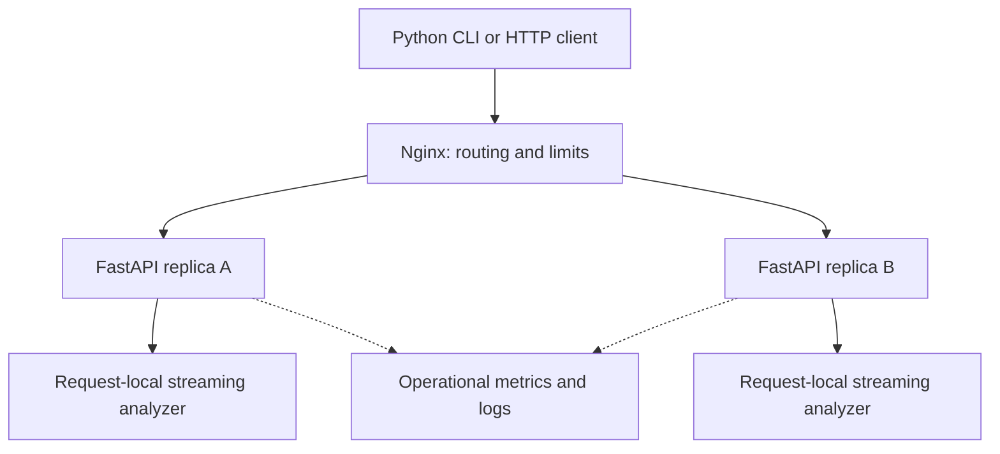
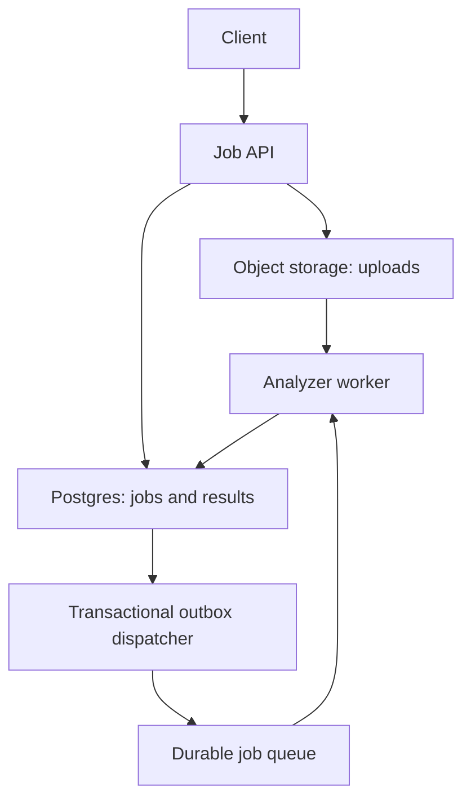

# LogScope — Product Requirements and Implementation Specification

Version: 1.0  
Prepared: 30 September 2026  
Delivery deadline: **1 October 2026, 11:00 AM IST (Asia/Kolkata)**  
Delivery objective: a complete, runnable, tested Python analyzer, REST API, and command-line HTTP client, with reproducible deployment and documented scaling behavior.

This document specifies the full implementation. It is a build contract, not a claim that the software has already been implemented or benchmarked. Performance figures below are acceptance targets to measure. The approximately 16-hour delivery window is used for implementation, verification, and handover.

## 1. Recommended design

Build a **stateless modular Python service** using FastAPI, a deterministic streaming analyzer, and an HTTPX command-line client. Package it with Docker. Provide a single-container development setup and a two-replica deployment behind Nginx to demonstrate horizontal scaling.

The analyzer processes bytes incrementally, validates each complete log line, and updates request-local counters. It retains neither the uploaded file nor all parsed records. Every request is independent, so any replica can answer it without shared application state.

Use AI to implement and review the code. Do not put an LLM in the runtime parsing path: the input grammar and counting rules are deterministic, and model calls would add latency, cost, privacy exposure, and inconsistent results.

The best architecture for this assignment is one that proves correctness, controls resource usage, and scales the workload actually requested. A queue, database, and distributed event pipeline become appropriate when durable jobs, historical queries, or continuous collection become requirements.

## 2. Problem, users, and outcome

Production logs contain useful failure signals, but manually finding and comparing errors across services is slow and error-prone. A developer or operator should submit a file and immediately see:

1. How many physical log lines were processed.
2. How many could not be parsed.
3. How many errors each observed service produced, including services with zero errors.
4. Which service or services have the highest error count.

Primary user story: “As an engineer investigating an incident, I want to upload a log file through a CLI or HTTP client and receive a reproducible summary of errors by service.”

The result describes the submitted file. Error volume alone does not establish root cause, current availability, business impact, or request failure rate. A high-volume service may naturally produce more log entries. A service absent from the file is unknown, not healthy. The interface must not claim otherwise.

The input systems may write continuously, but this release analyzes finite file snapshots. It does not tail files or continuously monitor a fleet.

## 3. Scope and delivery priorities

### 3.1 Required for this delivery

| ID | Requirement | Completion evidence |
|---|---|---|
| FR-01 | Reusable analyzer without HTTP dependencies | Unit tests import and run it directly |
| FR-02 | Exact error counts by service | Golden fixtures and independent expected results |
| FR-03 | Include valid services with zero errors | INFO/WARN/DEBUG-only fixture |
| FR-04 | Deterministic top offender and ties | Tie and zero-error tests |
| FR-05 | Correct total and unparseable line counts | Newline, empty-file, malformed-input tests |
| FR-06 | HTTP file submission returning JSON | Real server integration test and curl demo |
| FR-07 | CLI reads a disk file and sends it over HTTP | Subprocess CLI test against running server |
| FR-08 | Streaming with bounded retained input | Chunk boundary tests and measured RSS |
| FR-09 | Defined error policy and strict parsing rules | Contract tests for ERROR/FATAL and malformed lines |
| FR-10 | Limits, overload handling, and timeouts | Limit, saturation, timeout, disconnect tests |
| FR-11 | Installation, container, and replica deployment | Fresh-install and Compose smoke checks |
| FR-12 | Useful operational signals without leaking log contents | Structured-log and metrics inspection |
| FR-13 | Full documentation and repeatable verification | README, this PRD, CI, benchmark report |

All requirements above belong to the delivered version. “Future enhancement” must not be used to defer any of the three assignment parts.

### 3.2 Explicit future extensions

Persistent analysis history, browser dashboard, live tailing, log rotation tracking, multiline stack traces, lenient timestamp-free parsing, compressed archives, multipart upload support, asynchronous large-file jobs, automatic incident diagnosis, tenant accounts, alerts, and Kubernetes deployment are extensions. They are not needed to satisfy this file-analysis contract.

No paid services, API keys for AI, cloud account, external database, or broker should be required to run the deliverable locally.

## 4. Input and parsing contract

### 4.1 Accepted record

```text
2026-09-18 10:23:45 ERROR payment-service Connection timeout after 30s
```

Logical fields: `date time LEVEL service message`.

| Field | Rule |
|---|---|
| Date | Exactly `YYYY-MM-DD`; must be a valid calendar date |
| Time | Exactly `HH:MM:SS`; valid 24-hour time, seconds 00–59 |
| Level | Exactly one of `DEBUG`, `INFO`, `WARN`, `ERROR`, `FATAL` |
| Service | ASCII `[A-Za-z0-9][A-Za-z0-9._:/-]{0,127}` |
| Message | At least one character other than ASCII space or tab; may contain Unicode and spaces |
| Separators | One or more ASCII spaces or tabs between the five logical fields |
| Surrounding whitespace | Leading/trailing ASCII spaces and tabs are accepted |

Implementation decisions that clarify unspecified behavior:

- Level matching is case-sensitive. `error` is invalid in this strict format.
- Service names are case-sensitive. `Auth-Service` and `auth-service` are different services.
- Split at most four times so the entire message remains one field.
- Validate fixed timestamp shape first, then validate calendar/time values with `datetime`.
- No timezone is inferred from log timestamps; this release does not calculate time windows.
- The word `ERROR` inside an INFO message does not make that line an error.
- A malformed line contributes no service record and no error count.
- NUL or embedded carriage-return characters are invalid format. A CR immediately before the terminating LF is a line-ending marker and is removed.
- A multiline stack trace is processed as separate physical lines; continuation lines will normally be unparseable.
- Duplicate records are counted separately. Counting log lines is the requirement; deduplication would change it.

### 4.2 Meaning of “error”

Default: both `ERROR` and `FATAL` increment error counts. `FATAL` is included because it indicates a more severe failure, and excluding it would be surprising for incident triage.

Support `error_policy=error_only` for consumers that interpret the assignment literally as counting only the `ERROR` level. Default query value is `error_and_fatal`. These are the only accepted policy values in v1. The response includes the effective `error_levels` array.

The policy changes counting only. It does not change parsing. A FATAL-only service remains present with a zero count under ERROR-only policy.

### 4.3 Timestamp-free example

```text
error billing-service No Auth token
```

This line is **unparseable** under the specified grammar because the date and time are missing. Do not silently infer a timestamp or count it as a billing-service error. Supporting this separate format later requires an explicit versioned parser mode and separate tests.

### 4.4 Encoding and physical lines

- Accept UTF-8. Strip one UTF-8 BOM only at the start of the file before line framing.
- A BOM-only file is treated as empty.
- Support LF and CRLF, including CRLF split across incoming chunks.
- Do not interpret a bare CR as a newline.
- Each LF terminates one physical line, including an empty line.
- At EOF, a nonempty remaining byte sequence is one final line, even without LF.
- A trailing LF does not create an additional imaginary line.
- Empty file: zero lines. `\n`: one unparseable line. `\n\n`: two unparseable lines.
- Blank/whitespace-only lines count as processed and unparseable.
- Decode each completed byte line using strict UTF-8. An invalid byte sequence invalidates that line only; continue with later lines.
- Frame bytes before decoding, so a multibyte character split across transport chunks remains intact.
- Strip the single CR belonging to CRLF, not arbitrary CR bytes elsewhere.

### 4.5 Parse failure categories

Every rejected physical line has exactly one reason. Apply the following precedence:

1. `line_too_long`: physical line exceeds the byte limit; decoding is unnecessary.
2. `invalid_utf8`: bounded line cannot be decoded strictly.
3. `empty_line`: no content remains after horizontal whitespace trimming.
4. `invalid_format`: prohibited control character, fewer than five fields, or incorrect timestamp shape.
5. `invalid_timestamp`: correctly shaped but impossible calendar/time value.
6. `invalid_level`: level outside the accepted set.
7. `invalid_service`: service violates the documented service rule.
8. `empty_message`: fifth field contains only horizontal whitespace.

For a missing fifth field, use `invalid_format`; `empty_message` applies when a fifth field is present but blank. First check whether the whole line is blank without mutating it. Then remove leading horizontal whitespace and split on `[ \t]+` at most four times, preserving an empty fifth field when a separator follows the service. Only then check/trim the message. Do not trim trailing whitespace before splitting, since that would erase this distinction. Tests define this behavior explicitly.

Return counts by reason and up to the first ten `{line_number, reason}` diagnostics. Never return raw line contents. Line numbers are one-based and include malformed lines.

## 5. Output contract and examples

### 5.1 Invariants

```text
total_lines = parsed_lines + unparseable_lines
total_errors = sum(error_counts.values())
sum(parse_error_counts.values()) = unparseable_lines
0 <= total_errors <= parsed_lines
```

Every service from a valid line exists in `error_counts`, including zero-error services. Only observed valid services appear.

Top-offender rules:

- Positive maximum: `top_services` contains every tied service, sorted lexicographically.
- `top_service` is the first member of that list, for clients needing one deterministic answer.
- `top_error_count` is the maximum positive count.
- No errors: `top_service=null`, `top_services=[]`, and `top_error_count=0`, even if services were observed.
- Serialize `error_counts` in lexicographic service order for stable output. JSON clients must not depend on object ordering.
- The CLI sorts table rows by descending error count, then ascending service name.

### 5.2 Exact result for the supplied seven lines

Input fixture `examples/sample.log`:

```text
2026-09-18 10:23:45 ERROR payment-service Connection timeout after 30s
2026-09-18 10:23:46 INFO auth-service User login successful
2026-09-18 10:23:47 ERROR payment-service Connection refused
2026-09-18 10:24:01 WARN auth-service Response time degraded
2026-09-18 10:24:15 ERROR billing-service Invalid account state
2026-09-18 10:24:30 INFO payment-service Retry succeeded
error billing-service No Auth token
```

Expected JSON body:

```json
{
  "schema_version": "1.0",
  "total_lines": 7,
  "parsed_lines": 6,
  "unparseable_lines": 1,
  "total_errors": 3,
  "error_levels": ["ERROR", "FATAL"],
  "error_counts": {
    "auth-service": 0,
    "billing-service": 1,
    "payment-service": 2
  },
  "top_service": "payment-service",
  "top_services": ["payment-service"],
  "top_error_count": 2,
  "parse_error_counts": {"invalid_format": 1},
  "parse_error_samples": [
    {"line_number": 7, "reason": "invalid_format"}
  ]
}
```

Omit zero-valued parse-error reasons. For an empty file, counts are zero, maps and arrays are empty, `top_service` is null, and the selected `error_levels` and `schema_version` remain present.

Expected human-readable CLI output:

```text
Lines processed: 7
Unparseable lines: 1
Error levels: ERROR, FATAL

Service Name        Error count
payment-service               2
billing-service               1
auth-service                  0

Top offender: payment-service (2 errors)
```

For tied positive counts, print `Top offenders: billing-service, payment-service (2 errors each)`. For no errors, print `Top offender: none`.

## 6. System architecture

### 6.1 Deployment and ownership



The analyzer boxes are in-process modules, not independent network services. Responses return on the original HTTP connection. A direct local server runs without Nginx; the supplied scale profile adds it.

| Module | Responsibility | Must not do |
|---|---|---|
| Byte framer | BOM handling, LF framing, byte limits, overlong-line discard | Accumulate the complete file |
| Parser | Validate one bounded line and produce level/service or a typed failure | Know about HTTP, retain messages |
| Analyzer | Counters, service discovery, diagnostics, final summary | Hold global cross-request counters for results |
| API adapter | Headers, authentication, admission, streamed input, response model | Duplicate parser business rules |
| CLI | Snapshot file bytes, HTTP request, response validation, display | Reimplement server-side analysis |
| Configuration | Validate typed environment settings at startup | Scatter configuration reads through modules |
| Observability | Request metadata, aggregate metrics | Record raw uploaded content or credentials |

### 6.2 Why a modular service

The three required parts have clean code boundaries but do not need three deployed services. A network hop between parser and API would add deployment and failure modes without improving this workload. A standalone analyzer module remains reusable in future worker processes or offline utilities.

No database is required because the product does not promise history or durable result retrieval. No cache is required because duplicate-file frequency is unknown, cache keys need content hashing, and results may contain sensitive service identifiers. No queue is required for bounded synchronous uploads.

### 6.3 Streaming algorithm

1. Validate query, authentication, media type, and declared request length before consuming the body.
2. Try to reserve an active-analysis slot. Return a retryable overload error immediately if none is available.
3. Create a new analyzer for this request.
4. Iterate `Request.stream()` and count actual received bytes. A missing `Content-Length` never bypasses the limit.
5. Divide received data into bounded processing batches where necessary. Feed each batch sequentially into the analyzer through a bounded worker-thread offload.
6. The framer scans each byte segment once for LF. Retain at most the configured line bound plus a small delimiter allowance.
7. On an oversized line, increment the line/invalid counters once and discard until its LF or EOF. Resume normal parsing at the next line.
8. Parse each complete bounded line, update counts, and discard it immediately.
9. At EOF, process a remaining nonempty line exactly once. Finalize sorted results.
10. Return 200 only after the complete request finishes successfully. Release resources in `finally` on every path.

Do not use `await request.body()`, `read()` without a size, `readlines()`, or file-sized `splitlines()`. Do not concatenate an arbitrarily growing bytes object. Use an incremental bounded buffer and segment scanning to avoid quadratic copying on long unterminated lines.

Starlette exposes request-body streaming without requiring the complete body in application memory [S1]. This is the reason for choosing raw-body uploads for v1.

### 6.4 Async, CPU work, and cancellation

Async networking handles waiting for incoming bytes. It does not make Python parsing CPU-parallel. Offload bounded processing batches to a worker thread so the event loop is not occupied by a file-sized parsing loop. Await each batch before requesting more; do not create an unbounded task queue.

The default is one active analysis per API process. Additional replicas provide CPU parallelism and isolate resource usage. Benchmark before increasing per-process concurrency. Python threads are not assumed to deliver linear CPU scaling.

Only one thread may mutate a given analyzer at a time. A request cancellation must wait for an already-running bounded batch to finish before its admission slot is released. Do not abandon background work that continues parsing after the slot is reused. Bound batches to keep cancellation latency small.

### 6.5 Complexity

Let B be total bytes, S unique services, L the maximum retained line length, C a processing batch, and D the bounded diagnostic sample count.

- Parsing and aggregation: O(B).
- Sorting final service keys/ties: O(S log S).
- Analyzer memory: O(S + L + C + D).
- Response construction/serialization: O(S + D) additional memory.
- With A admitted analyses per process, request-specific memory scales approximately with A times the per-analysis bound, plus framework, socket buffers, and interpreter overhead.

Do not claim O(1) memory: the service dictionary grows with unique service names. A configured cardinality cap bounds that growth. ASGI servers may deliver chunks larger than the application processing batch; transport/server buffers and peak incoming-chunk memory must be measured separately.

## 7. HTTP API specification

### 7.1 Endpoints

| Method | Path | Behavior |
|---|---|---|
| POST | `/api/v1/analyses` | Analyze one file in the raw request body; return completed summary |
| GET | `/health/live` | Process/event loop liveness, without analysis admission |
| GET | `/health/ready` | Configuration loaded and process accepting work; false while draining |
| GET | `/metrics` | Prometheus-format operational metrics; internal access only |
| GET | `/docs` | Generated OpenAPI documentation |
| GET | `/openapi.json` | API schema including binary/text request body and JSON examples |

`POST` returns 200 because the analysis is complete and no persistent resource is created. There is no result ID or GET-by-ID endpoint in this release.

### 7.2 Request

```http
POST /api/v1/analyses?error_policy=error_and_fatal
Content-Type: application/octet-stream
Authorization: Bearer <token-if-enabled>

<raw UTF-8 file bytes>
```

- Accept `application/octet-stream` and `text/plain`.
- For `text/plain`, omitted charset or `charset=utf-8` is accepted; other charsets receive 415.
- Accept absent `Content-Encoding` or `identity`. Reject gzip and other encodings with 415.
- Missing or unsupported Content-Type receives 415.
- Accept a zero-byte body and return the empty summary.
- Do not require a filename or file extension. Never accept a server-side filesystem path or fetch a submitted URL.
- `multipart/form-data` receives 415 with guidance to send raw bytes. A multipart adapter can later reuse the same analyzer.
- Invalid/unknown query parameters receive 422 with the standard error envelope.
- Return `Content-Type: application/json`, `Cache-Control: no-store`, and a server-generated `X-Request-ID` on application responses.

Raw HTTP file submission meets the upload requirement. It avoids multipart parsing/spooling and gives explicit end-to-end byte limits. Document this choice prominently so users do not accidentally send `curl -F`.

### 7.3 Successful request examples

```bash
curl --fail-with-body \
  -H 'Content-Type: application/octet-stream' \
  --data-binary @examples/sample.log \
  http://127.0.0.1:8000/api/v1/analyses
```

```bash
curl --fail-with-body \
  -H 'Content-Type: text/plain; charset=utf-8' \
  --data-binary @examples/sample.log \
  'http://127.0.0.1:8000/api/v1/analyses?error_policy=error_only'
```

### 7.4 Error behavior

Malformed log records are data-quality results and normally produce **200**, with increased unparseable counts. Invalid requests and exhausted resources use non-2xx status codes.

| Status | Code | Trigger |
|---|---|---|
| 400 | `INVALID_REQUEST` | Malformed application-visible request metadata |
| 401 | `UNAUTHORIZED` | Missing/incorrect bearer token when enabled |
| 408 | `ANALYSIS_TIMEOUT` | Idle upload or total analysis deadline exceeded |
| 413 | `FILE_TOO_LARGE` | Declared or actual body exceeds configured limit |
| 415 | `UNSUPPORTED_MEDIA_TYPE` | Unsupported type, charset, or content encoding |
| 422 | `INVALID_OPTIONS` | Invalid or unknown query option |
| 422 | `SERVICE_LIMIT_EXCEEDED` | A valid line introduces a service beyond the cap |
| 429 | `RATE_LIMITED` | Edge rate limit, if enabled in a deployment |
| 503 | `SERVER_BUSY` | No admission capacity; include `Retry-After: 1` |
| 500 | `INTERNAL_ERROR` | Unexpected failure; no stack trace in response |

Standard application error body:

```json
{
  "error": {
    "code": "FILE_TOO_LARGE",
    "message": "The upload exceeds the configured 100 MiB limit.",
    "request_id": "server-generated-id"
  }
}
```

On body, cardinality, or time limits, return an error, not a partial successful summary. A truncated result would mislead incident investigation. Service-cap exhaustion is a resource/contract failure, not a parse error.

If the client disconnects, stop work and release capacity; do not attempt to promise delivery of a JSON response to a closed connection. Protocol rejections made by the HTTP server or edge may have a different body; the CLI must handle non-JSON errors. Configure common Nginx-generated 413/503 errors consistently where practical, without assuming every upstream transport failure can use the application schema.

## 8. CLI specification

Installed entry point: `logscope`.

```bash
logscope analyze examples/sample.log --server http://127.0.0.1:8000
logscope analyze examples/sample.log --server http://127.0.0.1:8000 --json
logscope analyze examples/sample.log --error-policy error_only
logscope analyze examples/sample.log --fail-on-unparseable
```

| Option | Default | Purpose |
|---|---|---|
| Positional file | Required | Readable regular file |
| `--server` | `LOGSCOPE_SERVER_URL`, else `http://127.0.0.1:8000` | API base URL |
| `--error-policy` | `error_and_fatal` | ERROR/FATAL or ERROR-only counting |
| `--json` | False | Emit validated server JSON only to stdout |
| `--fail-on-unparseable` | False | Return nonzero when analysis contains malformed lines |
| `--timeout` | 130 seconds | Total request wall-clock budget |

Use `LOGSCOPE_API_TOKEN` for credentials. Do not require passing secrets as CLI arguments. Default TLS certificate verification stays enabled. Redirect following is disabled so credentials and file contents are not silently forwarded to another host.

Client requirements:

- Read and send file data in 64 KiB chunks using HTTPX request streaming [S3].
- Obtain file size from the opened file descriptor and send exactly that many bytes. Appends after the start are excluded.
- If the file is truncated while reading, stop with a clear error. In-place edits cannot be made atomic by this client; recommend a copied snapshot of actively changing files.
- Validate file existence, readability, and regular-file type before networking.
- Validate response schema before formatting; report incompatible responses clearly.
- Print aligned columns and comma-grouped integer counts. Do not truncate service identifiers silently.
- Write human-readable failures to stderr; no traceback unless a development debug option is explicitly enabled.
- Do not print progress text to stdout in JSON mode.
- Configure connect timeout 5 seconds and read/write inactivity timeout 30 seconds, plus an actual monotonic total deadline. HTTPX inactivity timeouts alone are not a total wall-clock limit.
- Use an async upload generator with bounded thread-offloaded file reads, or another tested method that keeps the total timeout responsive during disk I/O.
- Do not retry uploads automatically in v1. Explain retryable 503/network errors and let the user rerun. Future bounded retries must reopen the same snapshot from byte zero.

Exit codes:

| Code | Meaning |
|---|---|
| 0 | Completed analysis, including zero errors; malformed lines allowed unless strict exit option selected |
| 1 | Network, server, timeout, or incompatible-response failure |
| 2 | CLI arguments, missing file, permissions, or local input failure |
| 3 | Completed analysis with unparseable lines and `--fail-on-unparseable` |

Detected service errors do not themselves mean that the CLI failed. This tool reports log data; it is not an implicit deployment gate.

## 9. Resource limits and deployment settings

Initial values are explicit engineering defaults, to be validated on the test machine:

| Setting | Default | Enforcement |
|---|---|---|
| `MAX_UPLOAD_BYTES` | 104,857,600 (100 MiB) | Early length check and actual streaming byte count |
| `MAX_LINE_BYTES` | 65,536 | Count once and discard oversized physical line |
| `MAX_SERVICES` | 10,000 | Abort before allocating the next service entry |
| `PROCESSING_CHUNK_BYTES` | 65,536 | Bounded sequential parser batches |
| `MAX_PARSE_ERROR_SAMPLES` | 10 | Keep earliest diagnostics only |
| `MAX_ACTIVE_ANALYSES` | 1 per process | Nonblocking admission before body read |
| `UPLOAD_IDLE_TIMEOUT_SECONDS` | 15 | Maximum wait for next body chunk |
| `ANALYSIS_TIMEOUT_SECONDS` | 120 | Upload + parsing + finalization deadline |
| `API_TOKEN` | Unset for loopback development | Bearer authentication when configured |
| `LOG_LEVEL` | INFO | Structured application events |

Line byte limits exclude LF and one CR belonging to CRLF; retain at most one extra CR candidate before deciding a line exceeds the limit. Limits are in bytes, not Unicode characters. Invalid environment values must prevent startup.

Admission must be genuinely nonblocking: do not check a semaphore value and later acquire in a separate scheduling window. Use a tested token-pool or guarded reservation operation. Health endpoints bypass analysis admission. All completion, exception, cancellation, and timeout paths release exactly one reserved slot.

### 9.1 Container delivery

- Python 3.12 as the selected runtime; this is a compatibility baseline, not a claim it is the latest Python release.
- Exact dependency versions resolved and committed in a lockfile after verification.
- One Uvicorn process per container. Run as a non-root user.
- Read-only root filesystem where practical; no writable upload directory needed.
- Health check, restart policy, and graceful SIGTERM handling.
- Initial container budget: 1 vCPU and 512 MiB; measure actual peak memory and throughput.
- Default local publication bound to `127.0.0.1`. Public deployment requires authentication and TLS.

### 9.2 Two-replica scale profile

Provide a runnable Compose profile with Nginx plus `api-a` and `api-b`. Both replicas use the same image and configuration. Nginx uses least-connections routing and disables request buffering for the analysis route.

Configure the edge body cap to match the application limit, upload idle timeout consistently, and upstream response timeout above the application's 120-second deadline, for example 135 seconds. Use HTTP/1.1 upstream and test chunked uploads through the proxy.

Only the edge publishes an external port. Keep metrics on the internal network or block `/metrics` at the public edge. Pass credentials without logging them. Prevent automatic proxy replay of POST uploads; a partially streamed body must not silently be retried against another replica.

Static Compose upstreams require testing restart/address-change behavior; a production service discovery/load balancer replaces this demo routing configuration. Least-connections is not exact CPU-aware scheduling. A busy replica may still return 503, which is an expected bounded-overload outcome.

During shutdown, mark readiness false and drain in-flight work up to the configured graceful budget. Set container termination grace above the maximum request deadline with a small margin. For the Compose demo, document its lack of production-grade health-aware routing during a rollout.

## 10. Scalability model and evolution

### 10.1 What scales in v1

Independent files can be distributed among replicas. A single file is processed by one replica. Adding replicas increases aggregate concurrent-file capacity; it does not automatically make one upload faster.

If a measured replica processes R bytes per second for a representative workload and there are N replicas, a rough CPU-side upper bound is N × R. Network bandwidth, shared host CPU, proxy behavior, service cardinality, and admission rejections can reduce it. Do not publish an unmeasured throughput figure.

A rough per-replica completed-request rate is inverse mean occupied-slot time at concurrency one; slot time includes upload time, not just parsing. This is why slow clients need deadlines and admission limits.

Scale on sustained CPU utilization, active-analysis saturation, and busy-response rate. Also watch upload latency and bandwidth; CPU-only autoscaling can miss slow-upload saturation. Replication does not require sticky sessions or distributed locks for this version [S2].

### 10.2 When to add durable background jobs

Add this architecture when legitimate uploads routinely exceed the synchronous size/deadline contract, users need resumable result retrieval, or worker restarts must not lose accepted work:



Future workflow: finalize upload, transactionally create job and outbox event, publish job ID, return 202 with a status URL, process asynchronously, and persist the completed result. Keep raw file bytes in object storage; queue only identifiers and metadata.

Use at-least-once delivery with idempotent result publication keyed by job ID and parser version. Use leases/heartbeats, bounded retry attempts, a dead-letter path, TTL retention, and authentication/tenant authorization. An outbox addresses the database/queue dual-write gap. Lifecycle cleanup must also remove abandoned uploads and expired results.

Do not describe ordinary FastAPI background tasks as a durable queue. They do not provide this failure-recovery contract.

### 10.3 When to support continuous logs

For actual always-on monitoring, adopt a collector such as Fluent Bit, centralized log storage, and a query/alert layer such as Loki/Grafana or Elastic. Continuous ingestion needs offsets, file rotation handling, replay/deduplication policy, late events, time-window semantics, and backpressure. Repeatedly resubmitting a growing file would recount old entries.

### 10.4 When to parallelize one large file

Only after measurement shows a need, split on complete line boundaries and merge partial summaries. Sum per-service and line counters, merge reason counts, select globally earliest diagnostic samples, then recompute top services. Never split arbitrary UTF-8 or line boundaries without carrying the incomplete boundary correctly. Global service limits and file-size validation remain coordinator responsibilities.

## 11. Technology decisions and alternatives

| Decision | Why selected here | Alternative and when it fits |
|---|---|---|
| FastAPI + Uvicorn | Typed response contracts, OpenAPI, async request streaming | Flask is reasonable for a simple synchronous service; Django/DRF fits a larger account/admin/data product |
| Standalone Python parser | Exact grammar, testability, no model dependency | Regex/Grok fits multiple extraction patterns; LLM parsing only for a different, explicitly probabilistic task |
| Raw-body upload | Direct stream, no form parser/spool, straightforward CLI | Multipart UploadFile is convenient for browser forms, but requires total-body and temporary-storage controls |
| One-pass counters | Minimal state, exact results, predictable cost | pandas is useful for exploratory tabular work but adds conversion/memory overhead here |
| Request-local state | Isolation and replica independence | Postgres needed for saved results, jobs, audit history, or tenants |
| Synchronous response | Matches “submit file, receive JSON”; simple client | Durable job API for long-running analysis or restart resilience |
| Processes/replicas | CPU parallelism and operational isolation | Threads help event-loop responsiveness; they do not guarantee parallel Python parsing |
| HTTPX + argparse | Streaming HTTP client, small CLI dependency surface | Typer/Rich improve complex CLI UX but are not necessary for one command |
| Docker + Compose | Reproducible local run and demonstrable replicas | Kubernetes for orchestrated production fleets, autoscaling, and rollout policies |
| No Redis/Kafka initially | No shared state or event replay requirement | Redis for a justified distributed cache/limiter; Kafka for durable continuous event streams |
| No result cache | Every request exact and independent, no retention questions | Cache immutable-file results only after repeat workload and privacy requirements are established |

Multipart is a viable alternative, not an inherently wrong design. Framework UploadFile implementations commonly spool data; iterating that object after parsing is different from parsing the network stream directly. A future multipart adapter must enforce total request size before/until spooling, bound file/field counts, close temporary resources, and reuse the same analyzer [S1].

Serverless is also viable for small bounded requests, but platform request-size, duration, and streaming behavior must be checked for the selected provider. A container gives this assignment a clearer reproducible execution contract.

## 12. Existing tools that solve related problems

These products offer comparable log-analysis capabilities; none is assumed to implement this exact file-upload API, CLI output, and malformed-line contract without configuration or a wrapper.

| Tool | Relevant capability | Tradeoff versus this assignment |
|---|---|---|
| Grafana Loki + Grafana | LogQL parses/filters logs and supports metrics such as `count_over_time`, aggregations, and top-k queries [S4] | Appropriate for retained logs and ongoing investigation; requires ingestion/query setup and explicit parse-failure handling |
| Elastic Stack: Logstash, Elasticsearch, Kibana | Grok extracts structured fields from log text for subsequent indexing and analysis [S5] | Flexible search and retention architecture; more infrastructure than a one-file counting service |
| Datadog Log Explorer | Search, filter, group, visualize, and export logs [S6] | Managed operational workflow; sends data to an external service and requires account/ingestion setup |
| Fluent Bit | Parses and transforms incoming logs in a collection pipeline [S7] | Useful collection component; a storage/query/reporting layer is still needed for the complete user workflow |
| A small Python script or awk pipeline | Deterministic local extraction and grouping | Useful baseline for one-off analysis; lacks the required remotely callable API unless extended |

Recommendation: implement the custom service to satisfy this precise engineering assignment. If the real operational goal expands to fleet-wide retention, search, dashboards, and alerts, evaluate an established logging stack before rebuilding those capabilities.

No vendor pricing is assumed. Choose based on deployment constraints, data handling, retention, query needs, and measured workload.

## 13. Security, privacy, and operational behavior

Required protections directly tied to this workload:

- Process only bytes supplied in the request. Never open a user-specified server path or URL.
- Do not persist uploaded data, include it in exception messages, or log request bodies.
- Enforce byte, line, service-cardinality, concurrency, idle, and total-time limits.
- Use deterministic bounded parsing and avoid complex expressions with catastrophic backtracking.
- Treat the uploaded text as data; never execute message content or interpolate it into shell commands.
- Use constant-time token comparison when bearer authentication is enabled.
- Require a token in the provided non-local deployment profile; use TLS at an appropriate edge for public hosting.
- Set `Cache-Control: no-store` on analysis responses. Error summaries still reveal service names.
- No CORS policy is needed for the CLI; do not add a wildcard browser access policy by default.
- Do not put service names, request IDs, filenames, or raw messages in Prometheus labels.

Structured request logs: request ID, route template, status, actual received bytes, elapsed milliseconds, summary totals on success, and exception type on failure. Do not log query strings containing potential credentials or supplied filenames.

Metrics: requests by route/status, analysis duration histogram, input-byte counter, active analyses gauge, busy rejection counter, and parsed/unparseable line counters. Per-request summaries are the correctness contract; metrics are operational and may not preserve counters across crashes.

Use one process per container to simplify metrics ownership. A Prometheus deployment can scrape both replicas separately; it is not required to install Prometheus for the demo. CPU/RSS measurements come from the benchmark/system monitoring path.

## 14. Repository and implementation interfaces

### 14.1 Required source layout

| Path | Contents |
|---|---|
| `pyproject.toml` | Package metadata, dependency groups, CLI entry point, lint/test configuration |
| `uv.lock` | Verified pinned dependency resolution |
| `src/logscope/core/framing.py` | Stateful bounded byte-line framing |
| `src/logscope/core/parser.py` | Strict record parsing and typed parse failures |
| `src/logscope/core/analyzer.py` | Request-local aggregation and finalization |
| `src/logscope/models.py` | Summary/error models and shared enums |
| `src/logscope/config.py` | Typed validated settings |
| `src/logscope/api/app.py` | App factory, routes, handlers, lifecycle |
| `src/logscope/api/admission.py` | Capacity reservation and release |
| `src/logscope/api/observability.py` | Structured logging and metrics |
| `src/logscope/cli.py` | CLI arguments, streamed submission, rendering |
| `tests/unit/` | Parser, framer, aggregation, formatting tests |
| `tests/integration/` | HTTP, CLI, concurrency, timeout/disconnect tests |
| `examples/sample.log` | Exact seven-line supplied fixture |
| `examples/expected_sample.json` | Expected deterministic response |
| `scripts/generate_logs.py` | Seeded fixture/benchmark generator with ground truth |
| `scripts/benchmark.py` | Reproducible correctness, timing, RSS, concurrency measurements |
| `Dockerfile` | Non-root API image |
| `compose.yaml` | Local service and optional two-replica scale profile |
| `deploy/nginx.conf` | Streamed proxy, limits, internal metrics restriction |
| `.env.example` | Documented non-secret configuration |
| `.github/workflows/ci.yml` | Frozen dependency install, lint, type checks, tests, build smoke check |
| `README.md` | Installation, commands, semantics, limitations, demo |
| `LogScope_Implementation_PRD.md` | This contract (canonical root document) |
| `docs/benchmark-results.md` | Actual measured environment and results |

Suggested runtime dependencies: FastAPI, Uvicorn, Pydantic, HTTPX, AnyIO, and prometheus-client. Use standard-library `argparse`, `datetime`, and logging. Development dependencies: pytest, pytest-asyncio or the chosen AnyIO test integration, Hypothesis, Ruff, mypy, and psutil. Resolve compatible versions at implementation time; do not mix examples from incompatible framework releases.

### 14.2 Core interfaces

```python
def parse_line(raw: bytes, line_number: int) -> ParsedRecord | ParseFailure:
    """Parse one bounded physical line, excluding its line terminator."""


class StreamingAnalyzer:
    def feed(self, chunk: bytes) -> None:
        """Accept the next byte segment; no HTTP dependencies."""

    def finish(self) -> AnalysisSummary:
        """Flush a final unterminated line and return the summary."""


def analyze_chunks(chunks: Iterable[bytes], *, settings, error_policy) -> AnalysisSummary:
    """Convenience adapter for synchronous offline tests and reuse."""


def create_app(settings: Settings | None = None) -> FastAPI:
    """Construct an isolated, testable application instance."""
```

ParsedRecord needs level and service only after validation; it does not need to retain message content or timestamps. Model parse failure reasons as an enum. `finish()` should cache its finalized result so repeated calls do not increment counts again; `feed()` after finalization raises a programmer-facing exception.

Use explicit domain exceptions for request-level byte/service limits. Do not catch all exceptions and reinterpret programming errors as malformed log lines.

## 15. Verification and acceptance tests

### 15.1 Functional cases

| Case | Required outcome |
|---|---|
| Original seven lines | Exact JSON from section 5 |
| Only INFO/WARN/DEBUG | Observed services have zero; no top offender |
| ERROR + FATAL | Both counted by default; only ERROR under alternate policy |
| Timestamp-free lowercase line | Unparseable, no service inferred |
| Lowercase level with valid timestamp | `invalid_level` |
| ERROR word in an INFO message | No error increment |
| Unknown level | Unparseable |
| Invalid date, leap date, time | Valid calendar cases accepted; invalid ones rejected |
| Empty and whitespace-only input | Exact physical-line semantics |
| LF, CRLF, no final LF | Correct totals without phantom final lines |
| UTF-8 split across chunks | Same result as unsplit input |
| Invalid UTF-8 in one line | Reject only that line; next valid line counted |
| BOM split across first chunks | Strip exactly one starting BOM |
| BOM-only input | Empty summary |
| Multiple services tied | Sorted tie list and deterministic singular top |
| Duplicate lines | Both counted |
| Line exactly at byte limit | Accepted if otherwise valid |
| Oversized line over many chunks | One invalid line; bounded buffer; subsequent line parsed |
| EOF during oversized line | Counted once; no extra line at finish |
| Thousands of malformed lines | Exact counts; diagnostic list remains capped |
| Service cap reached | Existing services still allowed; next new valid service aborts with 422 |
| Repeated `finish()` | No double counting |
| Feed after finalization | Explicit programming error |

Property-based tests: compare different chunk partitions of the same bytes, confirm line/count invariants, and verify record-order permutations preserve aggregate counts/top services while allowing line-number diagnostics to change. Expected output for fixed fixtures must be written independently, not produced by the same parser under test.

### 15.2 HTTP and CLI integration cases

- Real streamed upload with Content-Length and with chunked transfer through both direct API and Nginx.
- Empty upload, unsupported media/charset/encoding, invalid query, authentication failure.
- Exactly-at-limit and one-byte-over-limit bodies, including missing Content-Length.
- Simultaneous unrelated requests never share counters or diagnostics.
- Saturation returns 503 promptly; health endpoints remain accessible.
- Idle timeout and total timeout release admission capacity.
- Client disconnect mid-upload frees resources; a later request succeeds.
- Injected parser exception returns safe 500 and releases capacity.
- CLI human output, JSON-only output, ties, empty file, exit codes, missing file, refused connection, and malformed server response.
- CLI file growth does not extend the snapshotted upload; truncation reports a local failure.
- A slow test stream proves the CLI total deadline is enforced independently of inactivity timeout.
- Proxy-generated non-JSON errors produce readable CLI failures.
- API-token and raw-log sentinel strings never appear in captured application logs.
- Fresh install and both Compose profiles work using README commands.

Use small configurable limits and timeouts for automated tests instead of sleeping for production-length deadlines. Use real sockets for transport/disconnect/proxy behavior that an in-process ASGI test client cannot prove.

### 15.3 Performance and bounded-memory validation

Generate reproducible 1 MiB, 10 MiB, and 100 MiB files with fixed seeds, known service distribution, and independent expected counts. Cover a representative mixture, a long malformed line, and near-cap service cardinality. Report actual sizes and line counts; generation must produce whole records or explicitly document the final malformed record.

Initial targets on a documented 2-vCPU/4-GiB-or-better local environment:

| Metric | Target and method |
|---|---|
| Correctness | Exact expected counts at every tested size |
| 10 MiB upload latency | p95 under 5 seconds over loopback; warm-up then at least 30 measured requests |
| 100 MiB completion | Completes within configured 120-second application deadline |
| Memory | One analysis stays below 256 MiB process RSS on representative data; verify against 512 MiB container budget |
| Memory growth | With fixed service cardinality and line bound, file-size increases do not cause file-sized retained-memory growth |
| Health responsiveness | p95 under 500 ms during an admitted large analysis, with measurement environment reported |
| Overload | Bounded admitted work; excess receives 503 without growing an unbounded queue |
| Two replicas | Confirm both serve requests and measure aggregate accepted throughput plus busy rate; do not require an invented 2× speedup |

Measure process/container RSS, not only Python allocations. Report cold/warm conditions, Python/dependency versions, CPU/RAM, replica count, concurrency, error-policy settings, input cardinality, actual throughput, and rejected request counts. Slow WAN uploads are not covered by loopback latency targets.

If a target misses, profile the concrete bottleneck, fix it, and rerun the affected case. If hardware prevents meaningful measurement, mark the specific benchmark unverified; never invent passing numbers.

## 16. AI-assisted build plan to the deadline

The intended output is executable software, not scaffold files or an architecture-only submission. Use the AI coding assistant to implement one verified vertical slice at a time. This plan does not schedule autonomous future work; it is the implementation timetable.

All times are IST. Start as soon as this contract is accepted; the schedule below reserves a final buffer before **1 October, 11:00 AM**.

| Window | Implementation work | Required checkpoint |
|---|---|---|
| Sep 30, 19:15–20:30 | Repository, packaging, models, parser, seven-line golden test | Correct example and documented parsing policies |
| 20:30–22:00 | Bounded byte framer, analyzer, boundary/property tests | Chunk-invariant results; oversized lines cannot grow memory without bound |
| 22:00–23:30 | FastAPI route, raw stream, errors, limits, admission | curl gets exact response; overload and limit behavior tested |
| 23:30–00:30 | HTTPX CLI, formatting, snapshot reads, exit codes | End-to-end CLI against running API |
| Oct 1, 00:30–02:00 | Auth, timeouts, cancellation, diagnostics, metrics/logs | Resource release and no raw-log leakage |
| 02:00–03:30 | Docker, Nginx two-replica profile, OpenAPI, CI | Direct and proxied uploads run from clean commands |
| 03:30–05:30 | Full integration suite, malformed-input and concurrency review | No failing required contract tests |
| 05:30–07:00 | Generate workload, benchmark, targeted optimization | Honest measured performance report |
| 07:00–08:30 | Fresh environment install, README, demo transcript | Another person can reproduce the demonstration |
| 08:30–10:00 | Correctness review and fixes; rerun affected gates | Complete release candidate |
| 10:00–10:30 | Final package, checklist, source/archive handover | Deliverable ready before deadline |
| 10:30–11:00 | Reserved recovery/submission buffer | No discretionary feature additions |

If an early task overruns, use the review/buffer windows and avoid adding extensions. Do not silently remove mandatory analyzer, HTTP, CLI, correctness, or resource-control work. Resolve implementation choices autonomously within this contract; ask only when external requirements contradict it.

### 16.1 Copyable implementation directive

```text
Implement the complete LogScope project specified by LogScope_Implementation_PRD.md.

Deliver a working Python package, reusable streaming analyzer, FastAPI REST
server, HTTPX CLI, tests, Docker image, two-replica Compose/Nginx profile,
README, and measured benchmark report. Treat sections 4–9 as the contract.

Start with the exact seven-line fixture and its expected JSON. Implement the
core parser/framer first, then the HTTP adapter, then the CLI. Run the actual
server and submit a real file through the CLI. Use bounded streaming; never
load the complete upload or keep all parsed records in memory.

Do not stop after scaffolding, pseudocode, TODOs, mocked-only demos, or a plan.
Do not fabricate test results, benchmark numbers, or deployment success.
Keep request results isolated. Test ERROR/FATAL policy, malformed lines,
ties, empty files, chunk boundaries, UTF-8, limits, overload, cancellation,
timeouts, and CLI exit behavior. Keep raw logs and tokens out of telemetry.

Use current compatible dependency versions and commit a lockfile. Keep the
architecture modular and stateless. Do not add Redis, Kafka, a database,
LLM calls, or a web dashboard to the required version.

At handover, provide exact commands, executed test results, measured limits,
the source archive/repository, and any remaining verified limitations.
```

## 17. Runbook and demonstration contract

The implementation must make these commands work, or update the README and this section consistently if a deliberate packaging decision changes them:

```bash
uv sync --frozen --all-extras
uv run uvicorn logscope.api.app:create_app --factory --host 127.0.0.1 --port 8000 --no-access-log
```

In a second terminal:

```bash
uv run logscope analyze examples/sample.log --server http://127.0.0.1:8000
uv run logscope analyze examples/sample.log --server http://127.0.0.1:8000 --json
uv run pytest
uv run ruff check .
uv run mypy src
```

Declare test/tool dependencies in a dev extra so `--all-extras` installs them. If dependency groups are selected instead, change the documented sync command accordingly; do not ship mismatched instructions.

Container profile interface:

```bash
docker compose --profile local up --build
docker compose --profile scale up --build
```

Use separate host ports or require stopping the first profile before starting the second. Document that choice explicitly. The scale profile requires `API_TOKEN` set in the environment or a locally created, git-ignored `.env`; `.env.example` must not contain a production credential.

Suggested four-minute demo:

1. Start the server and show liveness/OpenAPI.
2. Run the CLI with the supplied fixture and verify all four required outputs.
3. Show malformed lines, a tie, and ERROR-only versus ERROR/FATAL.
4. Submit a generated larger file and show measured resource behavior.
5. Start the scale profile and demonstrate independent requests served by both replicas through operational logs.

## 18. Definition of done

- [ ] Analyzer works independently of the HTTP framework.
- [ ] Exact supplied example passes with 7 total, 1 unparseable, 3 errors.
- [ ] Zero-error services and deterministic ties are correct.
- [ ] ERROR/FATAL behavior is explicit and tested.
- [ ] Byte streaming, line accounting, UTF-8, and BOM handling pass boundary tests.
- [ ] Malformed lines do not crash the request or silently count as service errors.
- [ ] Body, line, service, concurrency, idle, and overall limits are enforced.
- [ ] Cancelled/failed requests release capacity without abandoned unbounded work.
- [ ] CLI submits real bytes to the server and prints readable output.
- [ ] JSON mode, exit codes, network errors, and snapshot semantics work.
- [ ] Authentication and safe telemetry behavior are verified.
- [ ] Single-container and two-replica deployments are runnable.
- [ ] Required tests, lint, and type checks pass; actual output is recorded.
- [ ] Benchmark report records real results and environment rather than promises.
- [ ] README includes exact setup, API, CLI, Docker, tests, and assumptions.
- [ ] No unfinished required-path TODOs, placeholder responses, or fake demos remain.
- [ ] Source package/repository and a short demonstration are ready before 11:00 AM IST.

## 19. Source references

Official documentation consulted on 30 September 2026. These sources establish framework/product capabilities; defaults, architecture decisions, schedules, and performance targets in this PRD are project-specific recommendations.

- **[S1] Starlette requests:** request streaming, uploaded files, and multipart behavior. [Official documentation](https://starlette.dev/requests/)
- **[S2] FastAPI deployment concepts:** replication, processes, memory, and deployment concerns. [Official documentation](https://fastapi.tiangolo.com/deployment/concepts/)
- **[S3] HTTPX quickstart:** binary and streaming request content, error handling, and timeouts. [Official documentation](https://www.python-httpx.org/quickstart/)
- **[S4] Grafana Loki metric queries:** log range functions and aggregation. [Official documentation](https://grafana.com/docs/loki/latest/query/metric_queries/)
- **[S5] Elastic Logstash Grok filter:** structured extraction from text logs. [Official documentation](https://www.elastic.co/docs/reference/logstash/plugins/plugins-filters-grok)
- **[S6] Datadog Log Explorer:** search, filtering, grouping, visualization, and export. [Official documentation](https://docs.datadoghq.com/logs/explorer/)
- **[S7] Fluent Bit parsers:** parsing within a log processing pipeline. [Official documentation](https://docs.fluentbit.io/manual/data-pipeline/parsers)
- **[S8] Python datetime:** date/time construction and validation. [Official documentation](https://docs.python.org/3/library/datetime.html)
