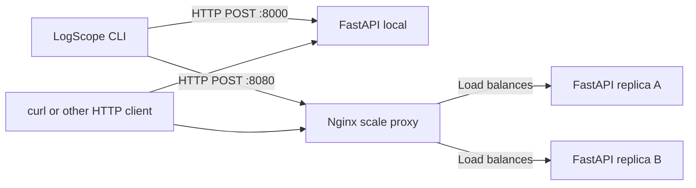
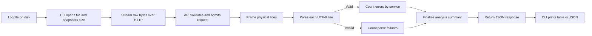

# LogScope

**Streaming log file analyzer** with a reusable core analyzer, FastAPI REST API, and HTTPX command-line client.

LogScope processes log files submitted via HTTP, counts errors by service, identifies the top offender, and reports parse failures — all with bounded memory using incremental streaming.

---

## Quick Start

### Prerequisites

- **Python 3.12+**
- **[uv](https://docs.astral.sh/uv/)** (recommended package manager)

### Install & Run

```bash
# Clone and install
cd LogScope
uv sync --frozen --all-extras

# Start the server
uv run uvicorn logscope.api.app:create_app --factory --host 127.0.0.1 --port 8000 --no-access-log
```

In a second terminal:

```bash
# Analyze the sample log file
uv run logscope analyze examples/sample.log --server http://127.0.0.1:8000

# JSON output
uv run logscope analyze examples/sample.log --server http://127.0.0.1:8000 --json

# With curl
curl --fail-with-body \
  -H 'Content-Type: application/octet-stream' \
  --data-binary @examples/sample.log \
  http://127.0.0.1:8000/api/v1/analyses
```

### Expected Output

```
Lines processed: 7
Unparseable lines: 1
Error levels: ERROR, FATAL

Service Name        Error count
payment-service               2
billing-service               1
auth-service                  0

Top offender: payment-service (2 errors)
```

---

## API Reference

### POST `/api/v1/analyses`

Analyze a log file. Send raw UTF-8 bytes in the request body.

**Query Parameters:**

| Parameter | Default | Values |
|---|---|---|
| `error_policy` | `error_and_fatal` | `error_and_fatal`, `error_only` |

**Headers:**

| Header | Required | Value |
|---|---|---|
| `Content-Type` | Yes | `application/octet-stream` or `text/plain` |
| `Authorization` | When `API_TOKEN` is set | `Bearer <token>` |

**Response (200):**

```json
{
  "schema_version": "1.0",
  "total_lines": 7,
  "parsed_lines": 6,
  "unparseable_lines": 1,
  "total_errors": 3,
  "error_levels": ["ERROR", "FATAL"],
  "error_counts": {
    "auth-service": 0,
    "billing-service": 1,
    "payment-service": 2
  },
  "top_service": "payment-service",
  "top_services": ["payment-service"],
  "top_error_count": 2,
  "parse_error_counts": {"invalid_format": 1},
  "parse_error_samples": [
    {"line_number": 7, "reason": "invalid_format"}
  ]
}
```

**Error Responses:**

| Status | Code | Trigger |
|---|---|---|
| 400 | `INVALID_REQUEST` | Malformed request metadata |
| 401 | `UNAUTHORIZED` | Missing/incorrect bearer token |
| 408 | `ANALYSIS_TIMEOUT` | Upload idle or total deadline exceeded |
| 413 | `FILE_TOO_LARGE` | Body exceeds configured limit |
| 415 | `UNSUPPORTED_MEDIA_TYPE` | Unsupported type, charset, or encoding |
| 422 | `INVALID_OPTIONS` | Invalid query parameter |
| 422 | `SERVICE_LIMIT_EXCEEDED` | Too many unique services |
| 503 | `SERVER_BUSY` | No analysis capacity |

### Other Endpoints

| Method | Path | Purpose |
|---|---|---|
| GET | `/health/live` | Process liveness |
| GET | `/health/ready` | Ready to accept work |
| GET | `/metrics` | Prometheus metrics |
| GET | `/docs` | OpenAPI documentation |
| GET | `/openapi.json` | OpenAPI schema |

---

## CLI Reference

```bash
logscope analyze <file> [options]
```

| Option | Default | Purpose |
|---|---|---|
| Positional file | Required | Any readable regular log file on disk |
| `--server` | `http://127.0.0.1:8000` | API base URL (or `LOGSCOPE_SERVER_URL`) |
| `--error-policy` | `error_and_fatal` | Error counting policy |
| `--json` | False | Output raw JSON to stdout |
| `--fail-on-unparseable` | False | Exit code 3 if unparseable lines exist |
| `--timeout` | 130s | Total request budget |

**Authentication:** Set `LOGSCOPE_API_TOKEN` environment variable.

**Exit Codes:**

| Code | Meaning |
|---|---|
| 0 | Analysis completed successfully |
| 1 | Network, server, or timeout failure |
| 2 | CLI arguments, missing file, or local error |
| 3 | Unparseable lines with `--fail-on-unparseable` |

---

## Log Format

```
YYYY-MM-DD HH:MM:SS LEVEL service-name Message text
```

- **Date**: Valid calendar date (`YYYY-MM-DD`)
- **Time**: Valid 24-hour time (`HH:MM:SS`, seconds 00–59)
- **Level**: `DEBUG`, `INFO`, `WARN`, `ERROR`, or `FATAL` (case-sensitive)
- **Service**: ASCII `[A-Za-z0-9][A-Za-z0-9._:/-]{0,127}`
- **Message**: At least one character other than ASCII space or tab

Lines that don't match this format are counted as unparseable with a categorized reason.

---

## Configuration

Settings are loaded from environment variables. See [`.env.example`](.env.example).

| Setting | Default | Description |
|---|---|---|
| `MAX_UPLOAD_BYTES` | 104,857,600 (100 MiB) | Maximum upload size |
| `MAX_LINE_BYTES` | 65,536 | Maximum line length in bytes |
| `MAX_SERVICES` | 10,000 | Maximum unique services per analysis |
| `PROCESSING_CHUNK_BYTES` | 65,536 | Maximum parser batch size |
| `MAX_PARSE_ERROR_SAMPLES` | 10 | First malformed-line diagnostics kept |
| `MAX_ACTIVE_ANALYSES` | 1 | Concurrent analyses per process |
| `UPLOAD_IDLE_TIMEOUT_SECONDS` | 15 | Max wait for next body chunk |
| `ANALYSIS_TIMEOUT_SECONDS` | 120 | Total analysis deadline |
| `API_TOKEN` | Unset | Bearer token (required for scale profile) |
| `LOG_LEVEL` | INFO | Logging level |

---

## Docker

### Single Container

```bash
docker compose --profile local up --build
# API available at http://127.0.0.1:8000
```

### Two-Replica Scale Profile

```bash
# Copy .env.example to .env, then set API_TOKEN there to a local secret.
# The .env file is git-ignored; the scale API refuses to start without a token.
cp .env.example .env

docker compose --profile scale up --build
# API available at http://127.0.0.1:8080 (through Nginx)
```

On PowerShell, use `Copy-Item .env.example .env` in place of `cp`.
Set `LOGSCOPE_API_TOKEN` to the same value before running the CLI against port 8080.

The profiles use different host ports (8000 and 8080) and can run together.
The scale proxy and API both cap uploads at 100 MiB; change both
`deploy/nginx.conf` and `compose.yaml` if this limit must change.
Nginx blocks public `/metrics` access. TLS is required at the edge for public hosting.
The demo proxy uses static Compose upstream names. A replica recreation passed a
20-request smoke check, but re-addressing is not guaranteed by this setup; restart
Nginx after replacing replicas. Use dynamic service discovery or a production load
balancer for deployments where replica addresses change independently.

---

## Development

### Tests

```bash
uv run pytest                     # All tests
uv run pytest tests/unit/         # Unit tests only
uv run pytest tests/integration/  # Integration tests only
```

### Lint & Type Check

```bash
uv run ruff check .
uv run mypy src
```

### Generate Test Data

```bash
uv run python scripts/generate_logs.py --size 10 --output examples/generated_10mb.log
```

### Benchmark

```bash
# Start server first, then:
uv run python scripts/benchmark.py --server-pid 1234
```

Replace `1234` with the Uvicorn process ID printed when the server starts.
The default run checks 1, 10, and 100 MiB files, uses 30 measured runs at 10 MiB,
and writes [the direct benchmark report](docs/benchmark-results.md).
See also the [special-workload report](docs/benchmark-special-results.md),
[two-replica report](docs/benchmark-scale-results.md), and
[512 MiB container report](docs/benchmark-container-results.md). The container
reports mark peak RSS unverified because the Windows benchmark process does not
sample Linux processes inside Docker.

---

## Architecture



Each FastAPI process runs its own copy of the streaming analyzer; the replicas
do not share request state or a database. The local profile listens on port
8000, while the scale profile listens through Nginx on port 8080.

### Data flow



Request validation can instead return an error response before parsing. A
successful result is returned to the caller, not saved by the server.

- **Byte Framer**: BOM handling, LF/CRLF framing, byte limits
- **Parser**: Strict field validation, typed failure reasons
- **Analyzer**: Request-local counters, no cross-request state
- **API Adapter**: Streaming upload, admission control, auth
- **CLI**: Snapshot file reads, HTTPX streaming, formatted output

The analyzer processes bytes incrementally and retains neither the uploaded file nor parsed records. Every request is independent — any replica can answer it.

---

## Limitations

- Analyzes finite file snapshots, not continuous log streams
- Single-file per request; no batch or multi-file upload
- No persistent result storage or retrieval by ID
- Multiline stack traces are processed as separate physical lines
- `multipart/form-data` is not supported (use raw bytes)
- No compressed upload support (gzip, etc.)

No Groq or other AI API key is required. Counting stays local and deterministic.
See [LogScope_Implementation_PRD.md](LogScope_Implementation_PRD.md) for the full specification.

---

## Project Structure

```
src/logscope/
  core/
    framing.py      # Byte-line framing
    parser.py       # Strict record parsing
    analyzer.py     # Streaming aggregation
  api/
    app.py          # FastAPI application
    admission.py    # Capacity control
    observability.py # Logging & metrics
  cli.py            # Command-line client
  models.py         # Domain models & enums
  config.py         # Typed settings
tests/
  unit/             # Parser, framer, analyzer
  integration/      # HTTP, CLI
examples/
  sample.log        # 7-line fixture
  expected_sample.json
scripts/
  generate_logs.py  # Fixture generator
  benchmark.py      # Performance measurement
deploy/
  nginx.conf        # Scale profile proxy
```
